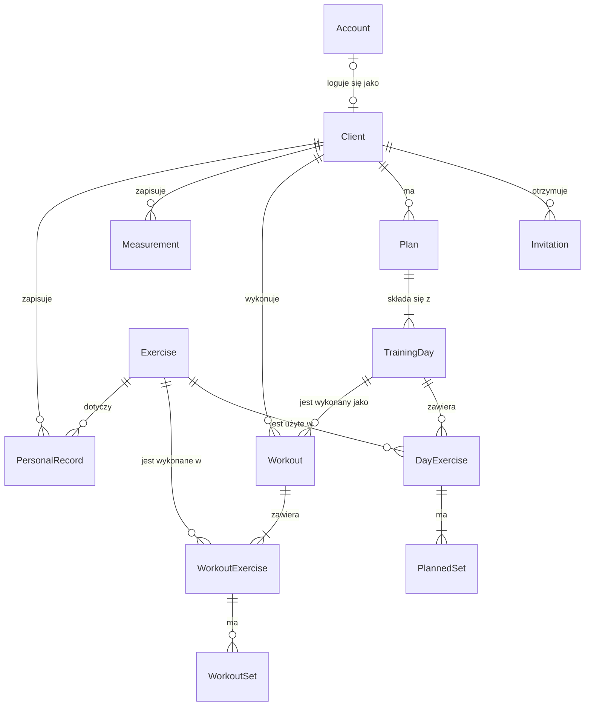

# Model domeny

- **Wersja:** 0.1 (szkic)
- **Data:** 2026-11-08
- **Powiązane:** [wymagania](wymagania.md) (v0.2), [decyzje architektoniczne](adr/README.md)

Dokument opisuje, jakie rzeczy istnieją w aplikacji, jak są ze sobą powiązane i jakie reguły ich dotyczą. To model pojęciowy: nie opisuje tabel ani klas, ale jest dla nich punktem wyjścia. Nazwy encji podajemy po angielsku, tak jak będą nazywać się w kodzie. Polskie pojęcia są w słowniku w wymaganiach (sekcja 4).

Dokument jest żywy: zmienia się razem z wymaganiami i kodem, w tym samym Pull Requeście.

## 1. Diagram

**Jak czytać linie:** symbol przy encji mówi, ile jej egzemplarzy może być po tej stronie relacji. `||` oznacza dokładnie jeden, `|o` zero albo jeden, `|{` jeden lub więcej, a `o{` zero lub więcej. Dokładne liczności (np. 1–7 dni w planie) są w regułach w sekcji 3, bo diagram ich nie wyraża.

## 2. Encje

### Konto i podopieczni

| Encja | Pojęcie | Opis | Najważniejsze dane |
|---|---|---|---|
| `Account` | Konto | Dane logowania. Ma je każdy, kto się loguje: trener i podopieczny | e-mail, skrót hasła, rola, czy zablokowane |
| `Client` | Podopieczny | Profil osoby prowadzonej przez trenera. Istnieje od chwili zaproszenia, także zanim powstanie konto | imię i nazwisko, e-mail, cel, data rozpoczęcia współpracy, notatka trenera, czy zarchiwizowany |
| `Invitation` | Zaproszenie | Jednorazowy link do ustawienia hasła, wysłany podopiecznemu | data wysłania, data wygaśnięcia, czy wykorzystane lub unieważnione |

### Biblioteka i plan

| Encja | Pojęcie | Opis | Najważniejsze dane |
|---|---|---|---|
| `Exercise` | Ćwiczenie | Pozycja w bibliotece: wspólna (dostarczona z aplikacją) albo własna trenera | nazwa, partia mięśniowa, sprzęt, link do filmu, opis, czy własne, czy ukryte |
| `Plan` | Plan | Program treningowy jednego podopiecznego na określoną liczbę tygodni | nazwa, liczba tygodni, data rozpoczęcia, sugerowane dni tygodnia, czy aktywny |
| `TrainingDay` | Dzień treningowy | Element kolejki dni w planie | nazwa, pozycja w kolejności |
| `DayExercise` | Pozycja w dniu | Ćwiczenie z biblioteki umieszczone w konkretnym dniu planu. Encja pośrednia między dniem a ćwiczeniem | pozycja w kolejności |
| `PlannedSet` | Seria planowana | Cel ustalony przez trenera dla jednej serii | powtórzenia albo czas, ciężar (opcjonalny), RIR (opcjonalny), przerwa |

### Trening

| Encja | Pojęcie | Opis | Najważniejsze dane |
|---|---|---|---|
| `Workout` | Trening | Jedno wykonanie dnia treningowego przez podopiecznego | data, status (pełny albo częściowy), kopia nazwy dnia |
| `WorkoutExercise` | Wykonane ćwiczenie | Ćwiczenie w ramach wykonanego treningu | pozycja w kolejności, czy pominięte, uwaga dla trenera |
| `WorkoutSet` | Wykonana seria | Wynik jednej serii razem z kopią celu z chwili wykonania | kopia celu (powtórzenia albo czas, ciężar, RIR), wynik (ciężar, powtórzenia), czy wykonana |

### Postępy

| Encja | Pojęcie | Opis | Najważniejsze dane |
|---|---|---|---|
| `Measurement` | Pomiar | Waga ciała i obwody z jednego dnia | data, waga, obwody: pas, biodra, klatka, ramię, udo |
| `PersonalRecord` | Rekord osobisty (1RM) | Ręcznie wpisany największy ciężar na jedno powtórzenie | ciężar, data |

## 3. Reguły

### Konto i podopieczni
- **R-01** E-mail konta jest unikalny bez względu na wielkość liter.
- **R-02** Podopieczny bez konta to podopieczny zaproszony, który nie ustawił jeszcze hasła. Konto bez podopiecznego to konto trenera.
- **R-03** Podopieczny ma najwyżej jedno ważne zaproszenie naraz. Wysłanie ponownego unieważnia poprzednie. Zaproszenie jest ważne 7 dni.
- **R-04** Zarchiwizowany podopieczny nie może się zalogować, a jego dane pozostają bez zmian.

### Biblioteka i plan
- **R-05** Nazwa własnego ćwiczenia jest unikalna w obrębie biblioteki trenera. Ćwiczeń wspólnych trener nie edytuje.
- **R-06** Ćwiczenia użytego w jakimkolwiek planie, treningu lub rekordzie nie usuwa się, tylko ukrywa. Dzięki temu wszystko, co na nie wskazuje, pozostaje poprawne.
- **R-07** Podopieczny ma najwyżej jeden aktywny plan. Aktywowanie nowego kończy poprzedni.
- **R-08** Plan ma od 1 do 52 tygodni i od 1 do 7 dni treningowych. Co najmniej jeden dzień ma co najmniej jedno ćwiczenie.
- **R-09** Dni treningowe wykonuje się po kolei, w pętli, według pozycji. Sugerowane dni tygodnia są tylko wskazówką.
- **R-10** Pozycja w dniu ma od 1 do 10 serii planowanych. Seria ma liczbę powtórzeń albo czas, nigdy oba naraz.

### Trening
- **R-11** **Migawka:** wykonana seria przechowuje kopię celu z chwili wykonania, a trening kopię nazwy dnia. Edycja planu nie zmienia historii. Ćwiczenie jest natomiast wskazywane, a nie kopiowane, więc zmiana jego nazwy obowiązuje także w historii.
- **R-12** Trening zapisuje się w całości albo wcale.
- **R-13** Zapisany trening (pełny lub częściowy) przesuwa kolejkę dni. Odrzucony trening nie jest zapisywany.

### Postępy
- **R-14** Podopieczny ma najwyżej jeden pomiar danego dnia. Ponowny zapis tego dnia nadpisuje poprzedni.
- **R-15** Waga mieści się w zakresie 30–300 kg, obwody w 10–250 cm, a ciężar rekordu w 1–500 kg. Data rekordu nie może być z przyszłości.

## 4. Wartości i wartości wyliczane

**Wartości** nie mają własnej tożsamości. Liczy się tylko ich treść, a zmiana polega na podstawieniu nowej wartości:

- rola konta (trener, podopieczny),
- cel podopiecznego (redukcja, masa, siła, zdrowie/sprawność),
- sugerowane dni tygodnia,
- RIR, ciężar, czas, liczba powtórzeń,
- obwody w pomiarze.

**Wartości wyliczane** nie są zapisywane. Oblicza się je z innych danych, kiedy są potrzebne, żeby nie rozjechały się z danymi źródłowymi:

| Wartość | Wyliczana z |
|---|---|
| Następny trening | aktywny plan + ostatni zapisany trening |
| Bieżący tydzień planu | data rozpoczęcia planu + dzisiejsza data |
| Frekwencja | liczba treningów w okresie + liczba dni treningowych w planie |
| Status podopiecznego (W-04) | aktywny plan, data ostatniego treningu, data końca planu, dzisiejsza data |
| Ostatni ciężar (podpowiedź w W-13) | ostatni trening podopiecznego z danym ćwiczeniem |
| Aktualny rekord | największy ciężar spośród rekordów podopiecznego w danym ćwiczeniu |

## 5. Świadome ograniczenia MVP

- **Brak powiązania podopiecznego z trenerem.** W MVP jest jeden trener, więc każdy podopieczny należy do niego. Powiązanie dochodzi razem z kolejnymi trenerami, jako zmiana działającego systemu: migracja danych (przypisanie istniejących podopiecznych do właścicielki), zmiana reguł dostępu i zachowanie zgodności wstecznej API (N-17).
- **Ćwiczenia własne są oznaczane flagą,** a nie powiązaniem z kontem trenera. Z tego samego powodu: przy jednym trenerze wystarcza informacja „własne albo wspólne”.
- **Brak szablonów planów.** Każdy dzień treningowy należy do dokładnie jednego planu.

## 6. Otwarte kwestie

| Nr | Kwestia | Rozstrzygnąć przy |
|---|---|---|
| M-01 | Co się dzieje, gdy trener usuwa z planu dzień, który był już wykonywany? Trening wskazuje na ten dzień (kolejka), a historia nie może się zmienić | kontrakcie API (edycja planu) |
| M-02 | Górny limit liczby ćwiczeń w jednym dniu treningowym (wymagania go nie określają) | kontrakcie API |

## Historia zmian

| Wersja | Data | Zmiany |
|---|---|---|
| 0.1 | 2026-11-08 | Pierwszy szkic |
